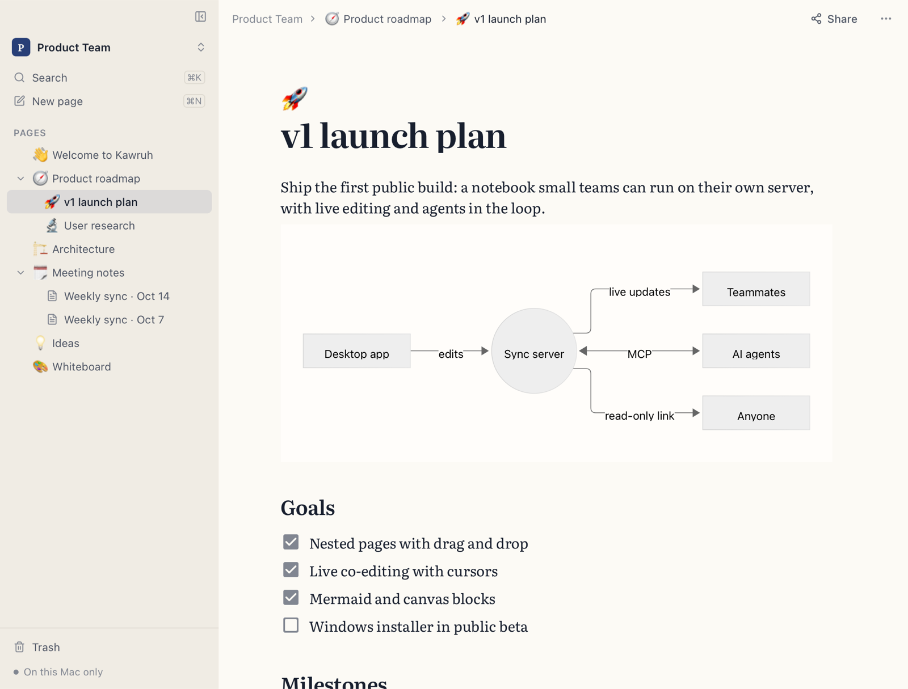
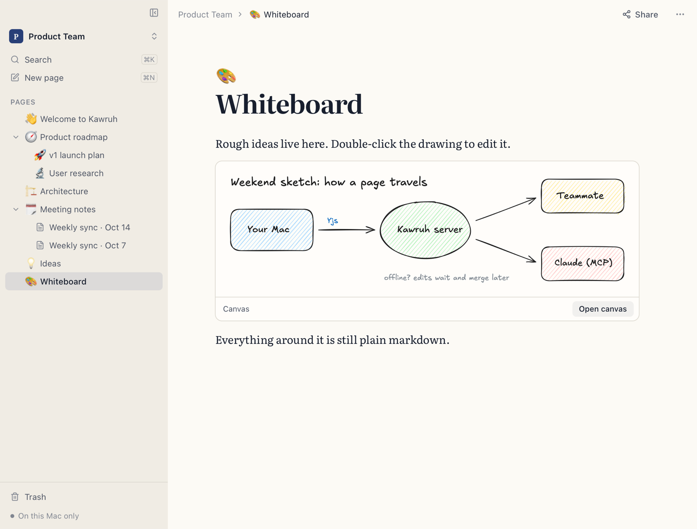
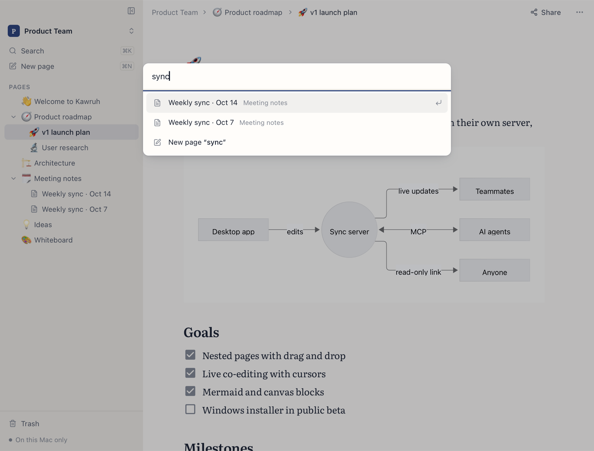

# Kawruh

A markdown notebook for the desktop. Pages nest like Notion, the editor is
WYSIWYG but everything is markdown underneath, and Mermaid diagrams, canvas
drawings, pasted screenshots and link cards live right in the page. Pick a serif,
sans or mono font, and export any page (with its sub-pages) as markdown or PDF. Workspaces stay on your computer until you publish
them to your own Kawruh server; then people edit together live, read-only links
can be shared, and AI agents can read and write pages over MCP.

*Kawruh* is Javanese for knowledge.

<picture>
  <source media="(prefers-color-scheme: dark)" srcset="docs/screenshots/hero-dark.png">
  
</picture>

| Canvas drawings sit inside the page | ⌘K jumps to any page |
|---|---|
|  |  |

## Download

Get the latest `.dmg` (macOS 11+, Apple Silicon and Intel) or `setup.exe`
(Windows 10/11) from [Releases](https://github.com/rakaadinugroho/kawruh/releases/latest).
The builds aren't signed by Apple or Microsoft yet, so the first launch takes one
extra click: on macOS, System Settings → Privacy & Security → **Open Anyway**; on
Windows, **More info → Run anyway**.

## How it fits together

```
Kawruh.app (Tauri 2)                         kawruh-server (homelab, :7420)
 React + Milkdown Crepe  ◄─IPC─►  Rust DocHub ──WS──►  sync · auth · shares · /mcp
 (mirror Y.Docs)                  (yrs + SQLite)        (yrs + SQLite)
```

- **Rust owns every document.** The webview edits mirror Yjs docs; Rust persists
  them in SQLite and syncs them. You can work offline; edits merge on reconnect.
- **Markdown is the contract.** `kawruh-core` converts markdown ↔ the editor's
  Yjs structure in Rust, checked against the editor's real schema
  (`crates/kawruh-core/schema.json`, `scripts/contract.sh`).
- Details: [docs/PLAN.md](docs/PLAN.md) (design), [docs/API.md](docs/API.md)
  (server API and sync protocol), [docs/MCP.md](docs/MCP.md) (agents).

```
crates/kawruh-core     shared: markdown↔Yjs, page tree, SQLite store, sync protocol + client
crates/kawruh-server   axum server: auth, workspaces, WS sync, share pages, MCP
app/                   desktop app: React UI (src/) + Tauri/Rust (src-tauri/)
deploy/                systemd unit, deploy and admin scripts for the homelab
```

## Develop

Requires Rust (stable), Node 22+ and pnpm. For deploying the server you also need
`zig` and `cargo-zigbuild` (`brew install zig && cargo install cargo-zigbuild`).

```sh
cd app && pnpm install
pnpm tauri dev                 # desktop app with hot reload
```

`app/.env.local` can set `VITE_DEFAULT_SERVER=http://<host>:7420` to prefill the
server field. `KAWRUH_DATA_DIR` points the app at another data folder (handy for
running two instances side by side).

Run a server locally:

```sh
KAWRUH_DATA=./data cargo run -p kawruh-server     # http://localhost:7420
```

## Build the app

```sh
cd app && pnpm tauri build                 # target/release/bundle/macos/Kawruh.app + .dmg
pnpm tauri build --bundles app             # just the .app
```

Local builds are ad-hoc signed; macOS opens them without complaint on the Mac that built them.

## Release

Pushing a version tag builds the macOS (universal `.dmg`) and Windows (`setup.exe`)
apps plus the server binaries on GitHub Actions and publishes them as a release:

```sh
scripts/release.sh 0.2.0 && git push --atomic origin main v0.2.0
```

Details, signing secrets and deploying a release build: [docs/RELEASE.md](docs/RELEASE.md).

## Server on the homelab

```sh
KAWRUH_SSH_PASS=… deploy/deploy.sh          # cross-compile (aarch64-musl), upload, restart
KAWRUH_SSH_PASS=… deploy/deploy.sh --release v0.2.0   # install a release build instead
KAWRUH_SSH_PASS=… deploy/deploy.sh --rollback
KAWRUH_SSH_PASS=… deploy/admin.sh list-users
KAWRUH_SSH_PASS=… deploy/admin.sh delete-user <name>   # also removes workspaces they own
curl http://<host>:7420/api/health
```

The scripts deploy to `KAWRUH_HOST` (`user@host`); put it in `deploy/.env.local`
(gitignored) so you don't have to type it.

Config lives in `/etc/kawruh/kawruh.env` (`KAWRUH_ALLOW_SIGNUP=false` closes
registration once everyone has an account); data in `/var/lib/kawruh`.

## Tests

```sh
cargo test --workspace          # converter round-trips, store, protocol, server integration
scripts/contract.sh             # Rust converter ↔ editor schema, both directions
cd app && pnpm test             # JS side of the contract
node app/tests/e2e/collab.mjs --server http://<host>:7420   # two live app instances, see the file header
```

Debug builds started with `KAWRUH_E2E_PORT` expose a localhost hook used by the
E2E script (`app/tests/e2e/ev.sh` evaluates JS, `snap.sh` snapshots the window).
It is compiled out of release builds.

## Known limits (v1)

- Tested on macOS. Windows builds and passes tests in CI but hasn't been tried on a
  real machine; its title bar keeps the macOS traffic-light gutter.
- Permissions are per workspace (owner / editor / viewer), not per page.
- Images up to 10 MB each (PNG, JPEG, GIF, WebP, AVIF). They aren't removed from
  the server when a page stops using them.
- The server speaks plain HTTP: use it on your LAN or over Tailscale. Exposing it
  publicly needs HTTPS in front (e.g. a Cloudflare tunnel).
- Server tokens are stored unencrypted in the app's local database.

## License

MIT, see [LICENSE](LICENSE).
