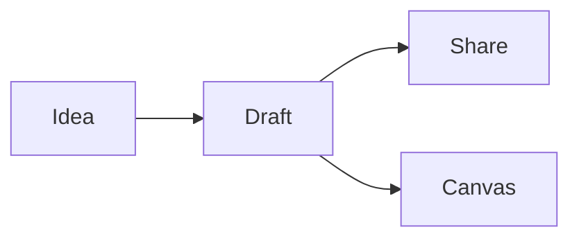

Kawruh is a markdown notebook. Everything you write here is plain markdown underneath, so you can export any page with **⋯ → Export markdown**.

## Write

- Type `/` on an empty line for blocks: headings, lists, to-dos, tables, code, **Mermaid diagrams** and **canvas drawings**.
- Select text for the formatting toolbar, or use markdown shortcuts like `**bold**`, `# heading`, `- list`.
- Drag the ⋮⋮ handle on the left of a block to move it.
- Paste screenshots and images straight in. Paste a link to keep it as a link, use the page title, or show it as a card or a preview.

## Organize

Pages nest like folders. Hover a page in the sidebar and click **+** to add a sub-page, drag pages to reorder or move them, and press **⌘K** (**Ctrl+K** on Windows) to jump anywhere.

## Diagrams

## Collaborate

Connect a Kawruh server in **Settings → Accounts**, then **Share** a workspace: invite people as editors or viewers, see their cursors live, and create read-only links for anyone.

AI agents can read and write your pages through the server's MCP endpoint. Create a token in **Settings → API tokens**.
